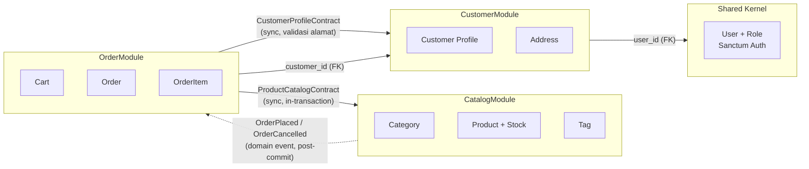
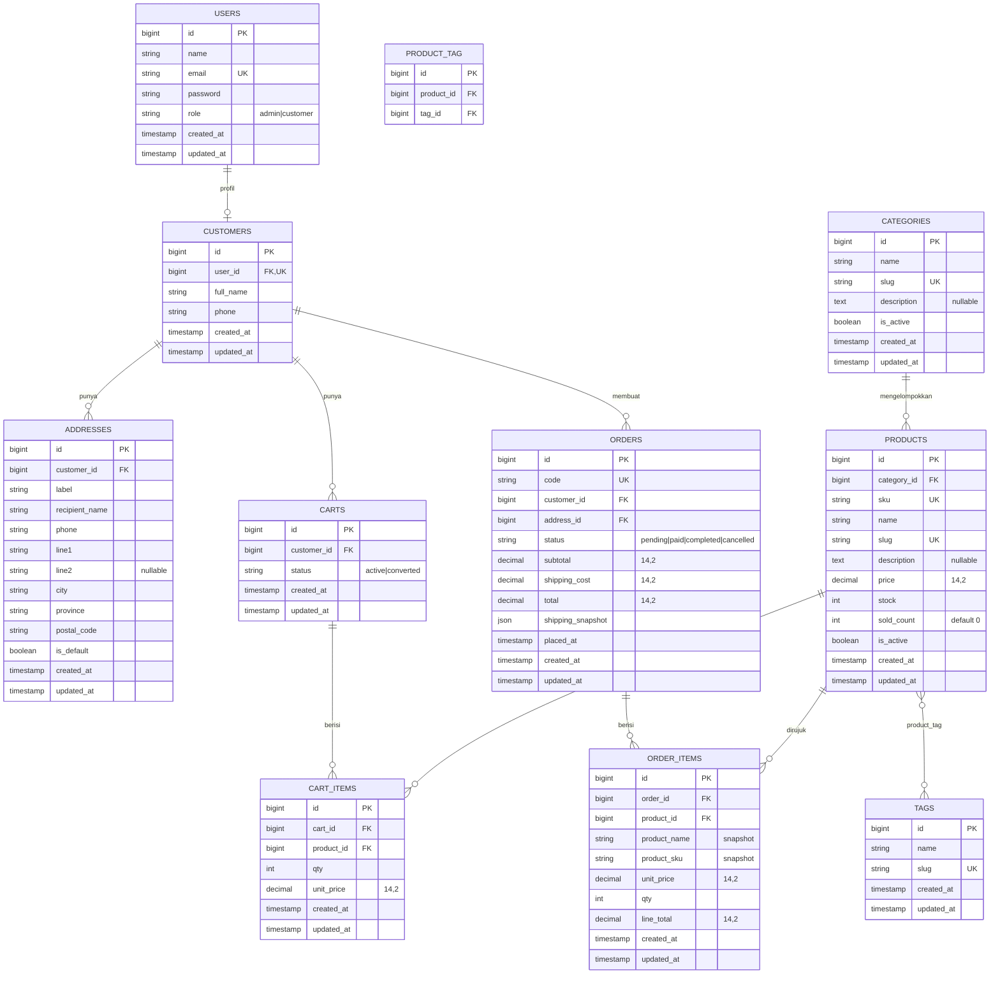

# Rancangan UTS Backend Development — Sistem E-Commerce Sederhana

Mata kuliah: DT199 Backend Development (4 SKS)
Semester: Ganjil 2026/2027
Kelompok: <isi nama kelompok>
Anggota: <nama 1 / NIM>, <nama 2 / NIM>, <nama 3 / NIM>
Kelas: <isi kelas>

> Catatan: pilihan studi kasus wajib dikonfirmasi ke dosen/asisten karena berlaku
> prinsip *first come, first served* per kelas.

---

## 1. Ruang Lingkup

Aplikasi e-commerce sederhana berbasis Laravel 13 dengan arsitektur modular monolith.
Tiga modul utama:

| Modul | Tanggung jawab |
|---|---|
| `CatalogModule` | Kategori, produk, stok, tag |
| `CustomerModule` | Profil pelanggan dan alamat pengiriman |
| `OrderModule` | Keranjang, checkout, pesanan, item pesanan |

Di luar tiga modul tersebut ada **shared kernel** berisi `User` dan autentikasi
(Sanctum). Shared kernel hanya menyimpan identitas login dan role, bukan data domain
salah satu modul.

Aktor dan hak akses:

- **Admin**: CRUD kategori, produk, tag, melihat semua pesanan, mengubah status pesanan.
- **Customer**: melihat katalog, mengelola keranjang, checkout, melihat pesanannya sendiri.

---

## 2. Bounded Context Diagram



Aturan batas modul:

1. `OrderModule` tidak boleh `use App\Modules\Catalog\Models\Product`.
   Yang di-import hanya `App\Modules\Catalog\Contracts\ProductCatalogContract`
   beserta DTO (`ProductSnapshot`, `CartItemData`).
2. Setiap modul mendaftarkan migration dan route sendiri lewat Service Provider:
   `loadMigrationsFrom()` dan `loadRoutesFrom()`.
3. Foreign key lintas modul tetap dipasang di level database untuk integritas data,
   tetapi pengambilan data selalu lewat Contract, bukan query Eloquent lintas modul.
4. Komunikasi yang tidak boleh menggagalkan request (misalnya pencatatan statistik)
   memakai Domain Event, bukan pemanggilan langsung.

---

## 3. Entity Relationship Diagram



### 3.1 Relasi wajib yang terpenuhi

| Ketentuan | Implementasi |
|---|---|
| One-to-Many | `categories` → `products`, `customers` → `addresses`, `orders` → `order_items`, `carts` → `cart_items` |
| Many-to-Many dengan pivot | `products` ↔ `tags` lewat tabel pivot `product_tag` (unique `product_id + tag_id`) |
| Relasi lintas modul | `orders.customer_id` → `customers.id`, `orders.address_id` → `addresses.id`, `cart_items.product_id` / `order_items.product_id` → `products.id` |

### 3.2 Catatan desain data

1. `order_items` menyimpan **snapshot** nama produk, SKU, dan harga saat checkout.
   Tujuan: riwayat pesanan tidak berubah ketika admin mengubah harga produk.
2. `orders.shipping_snapshot` menyimpan salinan alamat saat checkout, dengan alasan
   yang sama. `address_id` tetap disimpan sebagai referensi.
3. `carts` hanya boleh punya satu baris berstatus `active` per customer. Aturan ini
   dijaga di service layer karena MySQL belum mendukung partial unique index.
   Alternatif aman: `unique(customer_id, status)` bila status tidak dipakai ulang.
4. Uang memakai `decimal(14,2)`, tidak memakai `float`.
5. Semua tabel memakai `bigIncrements`, `timestamps`, dan foreign key dengan
   `->constrained()->cascadeOnUpdate()->restrictOnDelete()` kecuali disebut lain.

---

## 4. Penjelasan Modul

### 4.1 CatalogModule

Struktur:

```text
app/Modules/Catalog/
├── Contracts/ProductCatalogContract.php
├── DTO/ProductSnapshot.php
├── DTO/CartItemData.php
├── Exceptions/ProductNotFoundException.php
├── Http/Controllers/{CategoryController,ProductController,TagController}.php
├── Http/Requests/{StoreProductRequest,UpdateProductRequest,StoreCategoryRequest}.php
├── Models/{Category,Product,Tag}.php
├── Providers/CatalogServiceProvider.php
├── Routes/web.php
├── Services/{ProductCatalogService,StockService}.php
└── Database/{Migrations,Seeders,Factories}
```

`ProductCatalogContract` adalah satu-satunya pintu masuk modul lain:

```php
namespace App\Modules\Catalog\Contracts;

use App\Modules\Catalog\DTO\ProductSnapshot;

interface ProductCatalogContract
{
    /** @throws \App\Modules\Catalog\Exceptions\ProductNotFoundException */
    public function getForCheckout(int $productId): ProductSnapshot;

    /** @throws \App\Modules\Catalog\Exceptions\InsufficientStockException */
    public function reserveStock(int $productId, int $qty): void;

    public function releaseStock(int $productId, int $qty): void;
}
```

`reserveStock()` memakai `lockForUpdate()` agar dua checkout bersamaan tidak
menjual stok yang sama:

```php
DB::transaction(function () use ($productId, $qty) {
    $product = Product::whereKey($productId)->lockForUpdate()->first();
    if ($product === null) {
        throw new ProductNotFoundException($productId);
    }
    if ($product->stock < $qty) {
        throw new InsufficientStockException($product->name, $product->stock, $qty);
    }
    $product->decrement('stock', $qty);
    $product->increment('sold_count', $qty);
});
```

### 4.2 CustomerModule

Struktur:

```text
app/Modules/Customer/
├── Contracts/CustomerProfileContract.php
├── DTO/{CustomerSnapshot,AddressSnapshot}.php
├── Exceptions/AddressNotOwnedException.php
├── Http/Controllers/{ProfileController,AddressController}.php
├── Http/Requests/{UpdateProfileRequest,StoreAddressRequest}.php
├── Models/{Customer,Address}.php
├── Providers/CustomerServiceProvider.php
├── Routes/web.php
└── Services/CustomerProfileService.php
```

`CustomerProfileContract`:

```php
public function findByUserId(int $userId): CustomerSnapshot;
public function assertAddressBelongsTo(int $customerId, int $addressId): AddressSnapshot;
```

`assertAddressBelongsTo()` melempar `AddressNotOwnedException` jika alamat bukan milik
customer yang sedang login, sehingga order tidak bisa dikirim ke alamat orang lain.

### 4.3 OrderModule

Struktur:

```text
app/Modules/Order/
├── Contracts/OrderContract.php
├── DTO/CheckoutData.php
├── Events/{OrderPlaced,OrderPaid,OrderCancelled}.php
├── Exceptions/{EmptyCartException,OrderNotPayableException}.php
├── Http/Controllers/{CartController,CheckoutController,OrderController}.php
├── Http/Requests/{AddToCartRequest,CheckoutRequest}.php
├── Listeners/LogOrderActivity.php
├── Models/{Cart,CartItem,Order,OrderItem}.php
├── Providers/OrderServiceProvider.php
├── Routes/web.php
└── Services/{CartService,CheckoutService}.php
```

Alur checkout (wajib memakai `DB::transaction`):

1. Validasi form lewat `CheckoutRequest` (`address_id` wajib, `exists` divalidasi
   lewat Contract CustomerModule, bukan aturan `exists:addresses,id` yang menembus modul).
2. Mulai `DB::transaction`.
3. `CustomerProfileContract::assertAddressBelongsTo()` — pastikan alamat milik customer.
4. `CustomerProfileContract::findByUserId()` — ambil snapshot pelanggan dan alamat.
5. Untuk setiap item keranjang: `ProductCatalogContract::reserveStock()`.
6. Buat `orders` + `order_items` dengan snapshot harga dan nama.
7. Ubah status cart menjadi `converted`.
8. Commit, lalu `event(new OrderPlaced($order))`.

Jika `InsufficientStockException` dilempar di langkah 5, transaksi rollback sehingga
tidak ada stok yang terpotong dan tidak ada order setengah jadi.

Alur pembatalan: `OrderService::cancel()` memanggil `releaseStock()` untuk setiap item
di dalam transaksi, mengubah status menjadi `cancelled`, lalu memancarkan
`OrderCancelled`.

### 4.4 Kontrak antar modul dan Domain Event

| Mekanisme | Dipakai untuk | Sifat |
|---|---|---|
| `ProductCatalogContract` | baca produk, potong stok, kembalikan stok | sync, dalam transaksi, kegagalan menggagalkan checkout |
| `CustomerProfileContract` | ambil profil, validasi kepemilikan alamat | sync, dalam transaksi |
| `OrderPlaced` | `CatalogModule` menaikkan `sold_count`; listener log menulis riwayat | post-commit |
| `OrderPaid` | listener log, siap dikembangkan untuk notifikasi | post-commit |
| `OrderCancelled` | listener log | post-commit |

Binding dilakukan di Service Provider masing-masing modul:

```php
// CatalogServiceProvider::register()
$this->app->bind(ProductCatalogContract::class, ProductCatalogService::class);

// CustomerServiceProvider::register()
$this->app->bind(CustomerProfileContract::class, CustomerProfileService::class);
```

---

## 5. Autentikasi, Otorisasi, dan Keamanan

1. **Sanctum**: login/register memakai guard `web` + middleware `auth:sanctum`.
   Endpoint API opsional dapat menerbitkan personal access token.
2. **RBAC**: kolom `users.role` enum (`admin`, `customer`). Middleware
   `EnsureUserHasRole` didaftarkan dengan alias `role`.
3. **Protected routes**: seluruh route katalog admin memakai `auth` + `role:admin`.
   Keranjang dan checkout memakai `auth` + `role:customer`.
4. **Celah yang harus ditutup**:
   - Route admin tidak boleh hanya disembunyikan di Blade, harus dijaga middleware.
   - Customer tidak boleh membaca pesanan milik customer lain: gunakan scope
     `where('customer_id', $customer->id)` pada setiap query, bukan hanya
     `findOrFail($id)`.
   - CSRF aktif untuk seluruh form Blade.
   - Mass assignment dibatasi lewat `$fillable`.
5. **Rate limiting**: `throttle:60,1` pada grup route umum dan `throttle:10,1` pada
   login/register untuk memenuhi indikator keamanan API.

---

## 6. Validasi dan Penanganan Error

| Form | Form Request | Aturan utama |
|---|---|---|
| Kategori | `StoreCategoryRequest` / `UpdateCategoryRequest` | `name` wajib, unik per slug, maks 100 |
| Produk | `StoreProductRequest` / `UpdateProductRequest` | `price` numeric min 0, `stock` integer min 0, `category_id` exists |
| Tag | `StoreTagRequest` | `name` unik |
| Alamat | `StoreAddressRequest` / `UpdateAddressRequest` | `postal_code` 5 digit, `phone` 8–20 digit |
| Keranjang | `AddToCartRequest` | `qty` integer min 1 |
| Checkout | `CheckoutRequest` | `address_id` wajib dan milik customer |

Custom Exception:

| Exception | Kapan | Tampilan |
|---|---|---|
| `InsufficientStockException` | stok < qty saat checkout | alert merah "Stok <nama> tinggal X, diminta Y" |
| `ProductNotFoundException` | produk dihapus saat checkout | alert "Produk tidak tersedia" |
| `AddressNotOwnedException` | alamat bukan milik customer | alert "Alamat tidak valid" |
| `EmptyCartException` | checkout dengan keranjang kosong | alert "Keranjang masih kosong" |
| `OrderNotPayableException` | ubah status order yang tidak valid | alert status order |

Setiap exception mengimplementasikan `render()` agar pesan sampai ke View tanpa
menampilkan stack trace. `bootstrap/app.php` menangani `ValidationException` dan
`ModelNotFoundException` secara global.

---

## 7. Pemetaan ke Rubrik Penilaian

| Kriteria (bobot) | Bukti yang harus ada |
|---|---|
| Struktur Modular Monolith (15%) | Screenshot `app/Modules/`, tiga Service Provider, tidak ada `use` model lintas modul |
| Komunikasi Antar Modul (15%) | File Contract, binding di provider, Event + Listener, screenshot pemakaian |
| Relasi Antar Tabel (15%) | ERD di laporan, migration FK, pivot `product_tag`, bukti relasi jalan di tinker |
| Autentikasi & Otorisasi (10%) | Login/register Sanctum, middleware `role`, uji customer membuka route admin (403) |
| Validasi & Error Handling (10%) | Screenshot error validasi, screenshot `InsufficientStockException` |
| Database Transaction (10%) | Screenshot `DB::transaction` di `CheckoutService`, demo checkout gagal lalu stok tetap utuh |
| Kualitas Kode & Git (10%) | `vendor/bin/pint`, `git log --oneline --graph` dengan commit per anggota |
| Laporan & Dokumentasi (10%) | BAB I–V lengkap, diagram Mermaid di-export ke gambar |
| Video Demo (5%) | YouTube unlisted maks 10 menit |

---

## 8. Pembagian Tugas (2 anggota)

| Anggota | Modul / tugas | Deliverable |
|---|---|---|
| A | `CatalogModule` + `OrderModule`, setup project, Service Provider, migration, seeder, checkout transaksional, event/listener | CRUD produk/kategori/tag, contract katalog, keranjang, checkout, pembatalan, laporan BAB III–IV |
| B | `CustomerModule`, autentikasi Sanctum, RBAC, middleware `role`, seluruh tampilan Blade | Login/register, profil, alamat, halaman admin vs customer, pengujian |

Tugas bersama: ERD, pengujian, video demo, peer assessment.

---

## 9. Asumsi dan Risiko

1. Implementasi berjalan di **SQLite** karena server MySQL/MariaDB di mesin ini tidak
   bisa dijalankan tanpa akses administrator. Seluruh migration dan query dibuat
   portabel, sehingga pindah ke **MySQL 8+** cukup dengan mengubah `.env`.
   MySQL 5.7 bawaan MAMP tidak disarankan untuk Laravel 13.
2. Laravel 13 membutuhkan PHP 8.4+. Mesin ini memakai PHP 8.5, jadi aman.
3. Karena frontend memakai Blade, autentikasi dijalankan dengan sesi Sanctum, bukan
   token Bearer di JavaScript.
4. Video demo maksimal 10 menit: fokus pada tiga fitur wajib, satu kegagalan validasi,
   satu kegagalan stok, dan satu bukti rollback.
