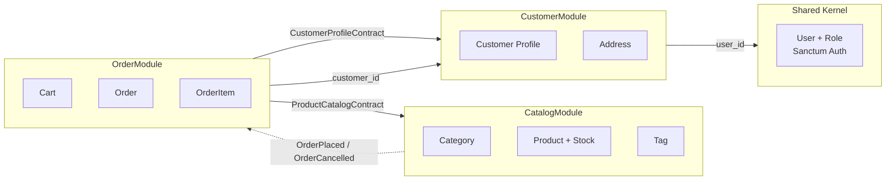
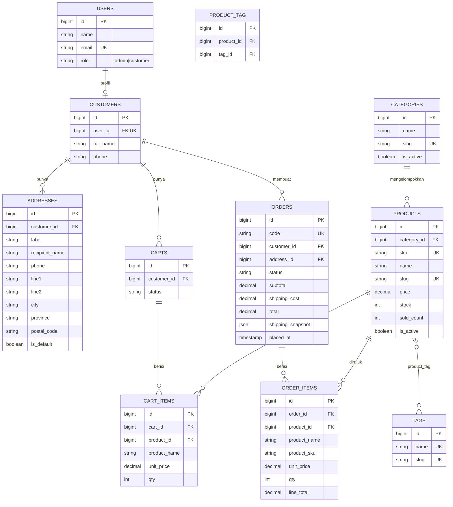

# LAPORAN UJIAN TENGAH SEMESTER

**SISTEM E-COMMERCE SEDERHANA BERBASIS LARAVEL 13**

Mata Kuliah: DT199 Backend Development (4 SKS)
Kelas: <Kelas>

**Disusun oleh:**

| No | Nama | NIM |
|----|------|-----|
| 1 | <Nama Anggota 1> | <NIM 1> |
| 2 | <Nama Anggota 2> | <NIM 2> |

**PROGRAM STUDI D3 TEKNIK INFORMATIKA**
**FAKULTAS ILMU KOMPUTER**
**UNIVERSITAS AMIKOM YOGYAKARTA**
**2026**

> Catatan: teks `<...>` wajib diganti. Setiap `[SCREENSHOT: ...]` wajib diganti
> tangkapan layar asli. Diagram Mermaid dapat diekspor menjadi gambar melalui
> https://mermaid.live.

---

# BAB I — PENDAHULUAN

## 1.1 Latar Belakang

Proses jual beli daring membutuhkan katalog, keranjang, dan checkout yang berjalan
konsisten. Pada praktiknya muncul dua masalah: stok dapat terjual melebihi jumlah
tersedia ketika dua pembeli checkout bersamaan, dan harga produk dapat berubah setelah
pesanan dibuat sehingga riwayat transaksi menjadi tidak akurat.

Kode aplikasi juga mudah membengkak bila model produk, pelanggan, dan pesanan saling
memanggil langsung. Arsitektur modular monolith menjaga batas antar modul melalui
contract dan domain event, sementara aplikasi tetap berjalan sebagai satu proses.
Kelompok membangun aplikasi e-commerce sederhana dengan Laravel 13 yang menerapkan
modular monolith, transaksi database pada checkout, Sanctum, RBAC, Form Request, dan
custom exception.

## 1.2 Tujuan

1. Membangun aplikasi e-commerce modular monolith dengan tiga modul terpisah.
2. Menerapkan komunikasi antar modul melalui Contract dan Domain Event.
3. Menerapkan relasi One-to-Many dan Many-to-Many dengan pivot.
4. Menerapkan autentikasi Sanctum, RBAC, dan protected route.
5. Menerapkan validasi Form Request, custom exception, dan transaksi database.

## 1.3 Ruang Lingkup

**Termasuk:** CRUD kategori, produk, dan tag; registrasi, login, profil, dan alamat
pelanggan; keranjang, checkout, pembayaran simulasi, dan pembatalan pesanan; RBAC
`admin` dan `customer`.

**Tidak termasuk:** payment gateway nyata, email/notifikasi, manajemen kurir, aplikasi
mobile, dan REST API terpisah.

---

# BAB II — PERANCANGAN

## 2.1 Bounded Context Diagram

Diagram berikut menunjukkan pembagian sistem menjadi tiga modul domain dan satu
shared kernel.



**`[SCREENSHOT: Bounded Context Diagram]`**

**Gambar 2.1** Bounded context: tiga modul domain dan satu shared kernel.

Sistem terdiri atas tiga modul domain dan satu shared kernel. Shared kernel hanya
menyimpan identitas login dan role.

## 2.2 Entity Relationship Diagram

ERD berikut menggambarkan seluruh tabel, foreign key, dan kardinalitas relasi yang
dipakai aplikasi. Tabel dipisahkan per modul agar perubahan pada satu modul tidak
merusak modul lain.



**`[SCREENSHOT: ERD]`**

**Gambar 2.2** ERD lengkap beserta relasi One-to-Many, Many-to-Many, dan foreign key antar modul.

Relasi wajib yang terpenuhi:

**Tabel 2.1** Pemenuhan ketentuan relasi pada ERD.

| Ketentuan | Implementasi |
|---|---|
| One-to-Many | `categories` → `products`, `customers` → `addresses`, `orders` → `order_items`, `carts` → `cart_items` |
| Many-to-Many dengan pivot | `products` ↔ `tags` melalui `product_tag` |
| Relasi lintas modul | `orders.customer_id`, `orders.address_id`, `cart_items.product_id`, `order_items.product_id` |

`order_items` dan `orders.shipping_snapshot` menyimpan salinan nama, harga, dan alamat
saat checkout agar riwayat pesanan tidak berubah ketika data produk atau alamat diedit.

## 2.3 Penjelasan Modul dan Alur Komunikasi

Setiap modul memiliki satu tanggung jawab utama dan hanya berkomunikasi melalui
contract atau domain event.

**Tabel 2.2** Tanggung jawab setiap modul.

| Modul | Tanggung jawab |
|---|---|
| `CatalogModule` | CRUD kategori, produk, tag; stok; katalog publik |
| `CustomerModule` | Profil pelanggan dan alamat pengiriman |
| `OrderModule` | Keranjang, checkout, pesanan, pembayaran, pembatalan |

**Komunikasi melalui Contract** (sinkron, di dalam transaksi):

- `ProductCatalogContract`: `getForCheckout`, `reserveStock`, `releaseStock`.
- `CustomerProfileContract`: `findByUserId`, `findById`, `createForUser`,
  `assertAddressBelongsTo`, `addressesFor`.

**Komunikasi melalui Domain Event** (setelah commit):

**Tabel 2.3** Domain event dan listener yang menanganinya.

| Event | Listener | Fungsi |
|---|---|---|
| `OrderPlaced` | `CatalogOrderListener` | menaikkan `sold_count` |
| `OrderCancelled` | `CatalogOrderListener` | menurunkan `sold_count` |
| `OrderPaid` | `LogOrderActivity` | menulis log aktivitas |

**Alur checkout:**

1. Customer mengirim `address_id` ke `CheckoutController`.
2. `CheckoutService` membuka `DB::transaction` dan memvalidasi alamat lewat
   `CustomerProfileContract`.
3. Setiap item dipotong stoknya lewat `ProductCatalogContract::reserveStock`.
4. Pesanan dan item pesanan dibuat, keranjang dikosongkan, lalu transaksi commit.
5. Event `OrderPlaced` dipancarkan untuk memperbarui statistik penjualan.

`OrderModule` tidak meng-import model `Product` atau `Customer` secara langsung.

---

# BAB III — IMPLEMENTASI

## 3.1 Struktur Direktori

Seluruh kode domain ditempatkan di `app/Modules` dan dipisahkan per bounded context.
Setiap modul memiliki folder migration, model, controller, request, route, service, dan
service provider sendiri, sehingga batas modul terlihat langsung dari struktur berkas.

```text
app/Modules/
├── Catalog/
│   ├── Contracts/ProductCatalogContract.php
│   ├── Database/{Migrations,Factories,Seeders}/
│   ├── Http/{Controllers,Requests}/
│   ├── Models/{Category,Product,Tag}.php
│   ├── Providers/CatalogServiceProvider.php
│   ├── Routes/web.php
│   └── Services/ProductCatalogService.php
├── Customer/
│   ├── Contracts/CustomerProfileContract.php
│   ├── Models/{Customer,Address}.php
│   ├── Providers/CustomerServiceProvider.php
│   └── ...
└── Order/
    ├── Events/{OrderPlaced,OrderPaid,OrderCancelled}.php
    ├── Models/{Cart,CartItem,Order,OrderItem}.php
    ├── Services/{CartService,CheckoutService,OrderService}.php
    └── ...
```

**`[SCREENSHOT: struktur direktori app/Modules/]`**

**Gambar 3.1** Struktur direktori `app/Modules` yang memisahkan kode per modul.

## 3.2 Implementasi Kode

Sub-bab ini menampilkan potongan kode yang mewakili tiap ketentuan implementasi:
Service Provider, relasi model, contract, Form Request, custom exception, dan controller.
Potongan kode diambil dari berkas asli tanpa diubah.

**Service Provider** — `CatalogServiceProvider` memuat migration, route, dan binding
contract:

```php
public function register(): void
{
    $this->app->bind(ProductCatalogContract::class, ProductCatalogService::class);
}

public function boot(): void
{
    $this->loadMigrationsFrom(__DIR__.'/../Database/Migrations');
    $this->loadRoutesFrom(__DIR__.'/../Routes/web.php');

    Event::listen(OrderPlaced::class, [CatalogOrderListener::class, 'onOrderPlaced']);
}
```

**`[SCREENSHOT: CatalogServiceProvider]`**

**Gambar 3.2** `CatalogServiceProvider` mendaftarkan binding contract, migration, route, dan listener event.

**Model dan Relasi** — One-to-Many dan Many-to-Many:

```php
// Product
public function category(): BelongsTo
{
    return $this->belongsTo(Category::class);
}

public function tags(): BelongsToMany
{
    return $this->belongsToMany(Tag::class, 'product_tag')->withTimestamps();
}

// Customer
public function addresses(): HasMany
{
    return $this->hasMany(Address::class);
}
```

**`[SCREENSHOT: model Product, Category, Customer]`**

**Gambar 3.3** Relasi `category()`, `tags()`, dan `addresses()` pada model.

**Contract** — batas akses modul lain:

```php
interface ProductCatalogContract
{
    public function getForCheckout(int $productId): ProductSnapshot;

    public function reserveStock(int $productId, int $qty): void;

    public function releaseStock(int $productId, int $qty): void;
}
```

**`[SCREENSHOT: ProductCatalogContract]`**

**Gambar 3.4** `ProductCatalogContract` sebagai satu-satunya jalur akses modul lain ke data produk.

**Form Request** — validasi input:

```php
public function rules(): array
{
    return [
        'category_id' => ['required', 'integer', 'exists:categories,id'],
        'sku' => ['required', 'string', 'max:50', 'unique:products,sku'],
        'price' => ['required', 'numeric', 'min:0'],
        'stock' => ['required', 'integer', 'min:0'],
    ];
}
```

**`[SCREENSHOT: StoreProductRequest dan CheckoutRequest]`**

**Gambar 3.5** Aturan validasi pada Form Request produk dan checkout.

**Custom Exception** — pesan informatif ke view:

```php
class InsufficientStockException extends Exception
{
    public function __construct(
        public readonly string $productName,
        public readonly int $available,
        public readonly int $requested,
    ) {
        parent::__construct("Stok {$productName} tinggal {$available}, diminta {$requested}.");
    }

    public function render(Request $request)
    {
        return back()->with('error', $this->getMessage());
    }
}
```

**`[SCREENSHOT: InsufficientStockException]`**

**Gambar 3.6** `InsufficientStockException` membawa nama produk, stok tersedia, dan jumlah diminta.

**Controller** — memakai contract, bukan model modul lain:

```php
public function store(AddToCartRequest $request): RedirectResponse
{
    $cart = $this->carts->activeCartFor($this->customerId($request));
    $product = $this->catalog->getForCheckout($request->integer('product_id'));

    $this->carts->add($cart, $product, $request->integer('qty'));

    return back()->with('success', $product->name.' ditambahkan ke keranjang.');
}
```

**`[SCREENSHOT: CartController dan CheckoutController]`**

**Gambar 3.7** Controller memakai contract, bukan model modul lain.

## 3.3 Konfigurasi Database Transaction

`CheckoutService` membungkus seluruh proses checkout dalam satu transaksi:

```php
[$order, $eventItems] = DB::transaction(function () use ($customer, $addressId): array {
    $address = $this->customers->assertAddressBelongsTo($customer->id, $addressId);

    $cart = Cart::where('customer_id', $customer->id)->active()->lockForUpdate()->first();

    foreach ($cart->items as $item) {
        $snapshot = $this->catalog->getForCheckout($item->product_id);
        $this->catalog->reserveStock($snapshot->id, $item->qty);
        // ...
    }

    // insert orders + order_items, kosongkan cart, ubah status cart

    return [$order->load('items'), $eventItems];
});

OrderPlaced::dispatch($order->id, $order->code, $customer->id, $eventItems);
```

Jika stok kurang, `InsufficientStockException` dilempar dan transaksi rollback sehingga
tidak ada stok terpotong atau pesanan setengah jadi.

**`[SCREENSHOT: CheckoutService::checkout]`**

**Gambar 3.8** `CheckoutService::checkout` di dalam `DB::transaction` dengan `lockForUpdate`.

## 3.4 Riwayat Commit Git

Riwayat commit disusun per fitur agar perubahan mudah ditelusuri. Setiap commit hanya
memuat satu topik, misalnya modul katalog, keranjang, atau perbaikan dokumentasi.

```text
* f234567 feat(catalog): ganti data contoh dengan produk nyata dan deskripsi lengkap
* a785faf test(docs): feature test alur checkout, smoke test halaman, dan laporan rancangan
* dad5bc5 feat(ui): autentikasi, RBAC, dan seluruh tampilan Blade
* 67aa0f6 feat(order): keranjang, checkout transaksional, pembayaran, dan pembatalan
* 998dc28 feat(customer): profil pelanggan, alamat, dan listener registrasi
* cc091a3 feat(catalog): modul katalog dengan contract, CRUD, seeder, dan pivot tag
* 9bb9b4e chore: bootstrap Laravel 13 dengan fondasi modular monolith
```

**`[SCREENSHOT: git log --oneline --graph]`**

**Gambar 3.9** Riwayat commit yang memisahkan pekerjaan per fitur.

## 3.5 Pembagian Tugas

Pekerjaan dibagi berdasarkan modul agar setiap anggota memegang satu batas domain.
Tabel 3.1 merangkum tugas dan berkas utama masing-masing anggota.

**Tabel 3.1** Pembagian tugas anggota kelompok.

| Anggota | Tugas | Berkas utama |
|---|---|---|
| <Nama 1> | Katalog, setup project, keranjang, checkout, transaksi, event, laporan | `app/Modules/Catalog/**`, `app/Modules/Order/**`, `docs/**` |
| <Nama 2> | Autentikasi, RBAC, profil dan alamat pelanggan, tampilan Blade, pengujian | `app/Modules/Customer/**`, `app/Http/**`, `resources/views/**`, `tests/**` |

**`[SCREENSHOT: GitHub Contributors]`**

**Gambar 3.10** Kontributor repositori sesuai pembagian tugas.

---

# BAB IV — PENGUJIAN

## 4.1 Hasil Pengujian Fitur Utama

Pengujian dijalankan dalam dua lapis: otomatis dengan PHPUnit dan manual melalui browser.
Hasil otomatis ditunjukkan pada blok berikut, sedangkan hasil manual dirangkum pada
tabel dan gambar di bawahnya.

```text
php artisan test  →  16 passed (63 assertions)
vendor/bin/pint  →  passed
```

**Tabel 4.1** Hasil pengujian fitur utama secara manual.

| No | Fitur | Skenario | Hasil |
|---|---|---|---|
| 1 | Login admin | Masuk dengan `admin@example.com` | Berhasil, menu admin tampil |
| 2 | Login customer | Masuk dengan `customer@example.com` | Berhasil, menu keranjang tampil |
| 3 | CRUD produk | Tambah, ubah, hapus produk | Data tersimpan dan tampil di katalog |
| 4 | CRUD kategori dan tag | Tambah kategori dan tag | Data tersimpan dan terhubung ke produk |
| 5 | Keranjang | Tambah dan ubah qty | Subtotal berubah sesuai jumlah |
| 6 | Checkout | Pilih alamat lalu buat pesanan | Pesanan `pending`, stok berkurang |
| 7 | Pembayaran | Bayar pesanan | Status menjadi `paid` |
| 8 | Pembatalan | Batalkan pesanan | Status `cancelled`, stok kembali |
| 9 | Admin selesai | Tandai pesanan selesai | Status menjadi `completed` |
| 10 | RBAC | Customer membuka route admin | HTTP 403 |

Bukti tiap skenario ditunjukkan pada gambar berikut.

**`[SCREENSHOT: halaman katalog]`**

**Gambar 4.1** Halaman katalog publik menampilkan produk beserta harga dan stok.

**`[SCREENSHOT: keranjang berisi item]`**

**Gambar 4.2** Keranjang berisi item dengan subtotal yang dihitung dari qty.

**`[SCREENSHOT: checkout]`**

**Gambar 4.3** Halaman checkout dengan pilihan alamat pengiriman.

**`[SCREENSHOT: detail pesanan]`**

**Gambar 4.4** Detail pesanan berstatus `pending` setelah checkout.

**`[SCREENSHOT: halaman admin produk]`**

**Gambar 4.5** Halaman admin produk untuk CRUD katalog.

**`[SCREENSHOT: hasil php artisan test]`**

**Gambar 4.6** Hasil `php artisan test`: 16 pengujian lulus.

## 4.2 Hasil Validasi

Validasi diuji dengan mengirim input yang salah dan input yang benar. Pesan error
diambil dari hasil validasi server, bukan dari pembatasan HTML.

**Validasi gagal:**

**Tabel 4.2** Validasi gagal beserta pesan yang tampil.

| Input | Pesan |
|---|---|
| SKU duplikat (`ELK-001`) | "SKU sudah dipakai produk lain." |
| Kode pos `abc` | "Kode pos harus terdiri dari 5 digit angka." |
| Checkout tanpa memilih alamat | "Pilih alamat pengiriman terlebih dahulu." |
| Email sudah terdaftar | "Email sudah terdaftar." |
| Password kurang dari 8 karakter | "Password minimal 8 karakter." |

**`[SCREENSHOT: form produk dengan pesan error]`**

**Gambar 4.7** Validasi server menolak SKU duplikat dan menampilkan pesan error.

**`[SCREENSHOT: form checkout tanpa alamat]`**

**Gambar 4.8** Checkout tanpa alamat terpilih ditolak dengan pesan validasi.

**Validasi berhasil:**

**Tabel 4.3** Validasi berhasil beserta hasilnya.

| Input | Hasil |
|---|---|
| Produk dengan data lengkap | Produk tersimpan |
| Alamat dengan kode pos valid | Alamat tampil di daftar |
| Checkout dengan alamat valid | Pesanan dibuat |
| Registrasi email baru | Akun dan profil pelanggan terbentuk |

**`[SCREENSHOT: form produk berhasil disimpan]`**

**Gambar 4.9** Produk baru tersimpan dan muncul di daftar produk.

## 4.3 Hasil Error Handling

Error handling diuji pada kondisi yang tidak dapat dicegah oleh validasi form, yaitu
perubahan data di antara waktu keranjang diisi dan checkout. Tabel 4.4 merangkum
perilaku sistem pada tiap kasus.

**Tabel 4.4** Perilaku sistem pada tiap kasus error.

| Kasus | Perilaku |
|---|---|
| Stok tidak cukup | Pesan "Stok ... tinggal X, diminta Y.", stok tidak berubah, tidak ada pesanan |
| Alamat milik customer lain | Pesan "Alamat pengiriman tidak valid...", tidak ada pesanan |
| Keranjang kosong | Diarahkan ke `/cart` dengan pesan "Keranjang masih kosong..." |
| Akses admin oleh customer | HTTP 403 "Anda tidak memiliki akses..." |

**`[SCREENSHOT: error stok kurang]`**

**Gambar 4.10** Checkout gagal karena stok tidak cukup; stok dan jumlah pesanan tidak berubah.

**`[SCREENSHOT: error alamat tidak valid]`**

**Gambar 4.11** Alamat milik pelanggan lain ditolak oleh validasi server.

**`[SCREENSHOT: halaman 403]`**

**Gambar 4.12** Customer yang membuka route admin mendapat HTTP 403.

## 4.4 Video Demo

Video demo menampilkan alur utama aplikasi dalam satu kali perekaman.

- URL: `[ISI LINK YOUTUBE UNLISTED]`
- Durasi: `<...>` menit (maksimal 10 menit)

---

# BAB V — KESIMPULAN DAN SARAN

## 5.1 Kesimpulan

1. Aplikasi e-commerce berhasil dibangun sebagai modular monolith Laravel 13 dengan
   tiga modul terpisah dan Service Provider masing-masing.
2. Batas modul ditegakkan melalui `ProductCatalogContract` dan
   `CustomerProfileContract`; `OrderModule` tidak mengakses model modul lain.
3. Domain Event `OrderPlaced`, `OrderPaid`, dan `OrderCancelled` memisahkan efek
   samping non-kritis dari alur transaksi utama.
4. Transaksi database pada checkout mencegah stok negatif dan pesanan setengah jadi;
   pembatalan pesanan mengembalikan stok.
5. Sanctum, RBAC, Form Request, dan custom exception berjalan sesuai kebutuhan,
   dibuktikan oleh 16 pengujian otomatis yang lulus.

## 5.2 Saran

1. Menambahkan Policy Laravel agar aturan otorisasi juga berada di level model.
2. Memindahkan pemrosesan event ke queue agar respons checkout lebih cepat.
3. Menambahkan payment gateway nyata dan status pembayaran terpisah.
4. Melengkapi REST API dengan Sanctum token untuk aplikasi mobile.

---

# LAMPIRAN

**Lampiran A — Repository GitHub (public):** `[ISI LINK]`

**Lampiran B — Video Demo (YouTube unlisted):** `[ISI LINK]`

**Lampiran C — Form Peer Assessment:**

**Tabel L.1** Form peer assessment.

| Nama anggota | Kontribusi | Nilai rekan (1–100) |
|---|---|---|
| <Nama 1> | <...> | <...> |
| <Nama 2> | <...> | <...> |
