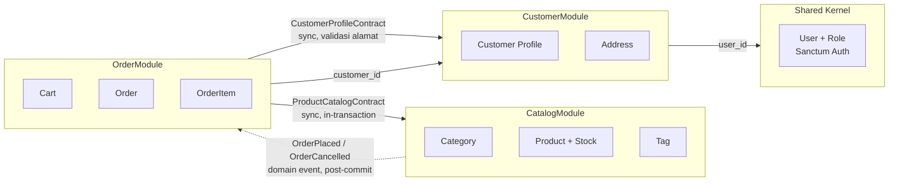
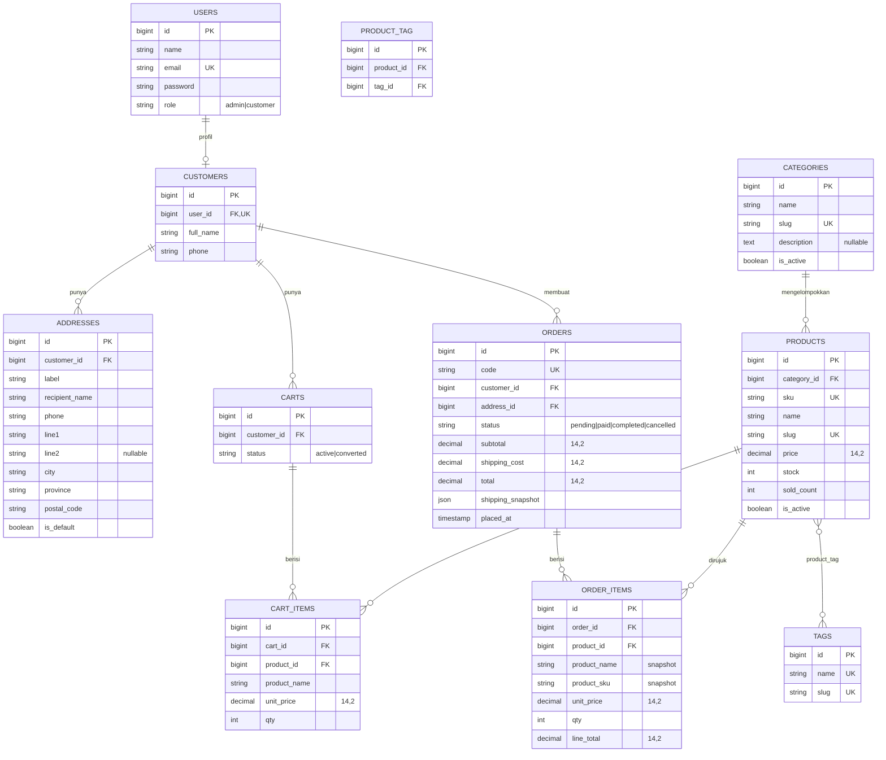
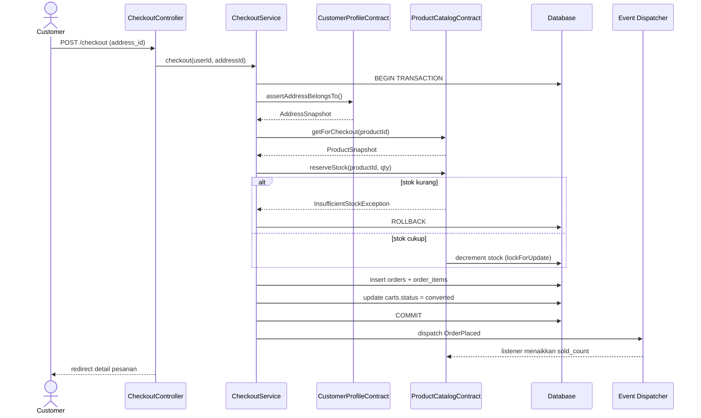

# LAPORAN UJIAN TENGAH SEMESTER

**SISTEM E-COMMERCE SEDERHANA**
**MODULAR MONOLITH BERBASIS LARAVEL 13**

Disusun untuk memenuhi Ujian Tengah Semester
Mata Kuliah DT199 Backend Development (4 SKS)


**Disusun oleh:**

| No | Nama | NIM |
|----|------|-----|
| 1 | <Nama Anggota 1> | <NIM 1> |
| 2 | <Nama Anggota 2> | <NIM 2> |
| 3 | <Nama Anggota 3> | <NIM 3> |

**Kelas:** <Kelas>
**Program Studi:** D3 Teknik Informatika
**Fakultas:** Ilmu Komputer

**UNIVERSITAS AMIKOM YOGYAKARTA**
**2026**

---

## DAFTAR ISI

1. [BAB I — Pendahuluan](#bab-i--pendahuluan)
2. [BAB II — Perancangan](#bab-ii--perancangan)
3. [BAB III — Implementasi](#bab-iii--implementasi)
4. [BAB IV — Pengujian](#bab-iv--pengujian)
5. [BAB V — Kesimpulan dan Saran](#bab-v--kesimpulan-dan-saran)
6. [Lampiran](#lampiran)

> Catatan penulisan: semua teks bertanda `<...>` wajib diganti sebelum laporan
> diunggah. Setiap kotak bertanda **`[SCREENSHOT: ...]`** harus diganti dengan
> tangkapan layar asli dari aplikasi. Diagram Mermaid dapat diekspor menjadi gambar
> melalui https://mermaid.live atau ekstensi Mermaid di VS Code.

---

# BAB I — PENDAHULUAN

## 1.1 Latar Belakang

Toko daring saat ini dituntut melayani katalog produk, keranjang, dan proses checkout
dalam satu alur yang cepat. Kebutuhan tersebut terlihat sederhana, tetapi menyimpan
masalah teknis yang nyata: stok dapat terjual dua kali ketika dua pembeli menekan
tombol checkout hampir bersamaan, harga produk dapat berubah setelah pesanan dibuat,
dan data pesanan lama harus tetap menampilkan harga saat transaksi terjadi.

Selain masalah domain, kode aplikasi e-commerce mudah membengkak menjadi satu kesatuan
yang sulit dirawat. Model produk, pelanggan, dan pesanan saling memanggil langsung
sehingga perubahan kecil di satu bagian merusak bagian lain. Arsitektur *modular
monolith* menjawab masalah ini: aplikasi tetap satu proses dan satu deployment, tetapi
batas antar modul ditegakkan melalui kontrak dan event.

Berdasarkan hal tersebut, kelompok membangun aplikasi e-commerce sederhana dengan
Laravel 13 yang menerapkan modular monolith, transaksi database pada proses checkout,
autentikasi Sanctum, RBAC, validasi Form Request, serta custom exception yang
menampilkan pesan kesalahan informatif.

## 1.2 Tujuan

1. Membangun aplikasi e-commerce modular monolith dengan minimal tiga modul terpisah.
2. Menerapkan komunikasi antar modul melalui *Contract* dan *Domain Event* tanpa akses
   langsung ke model modul lain.
3. Menerapkan relasi One-to-Many dan Many-to-Many dengan pivot pada database.
4. Menerapkan autentikasi Sanctum, RBAC dua role, dan protected route.
5. Menerapkan validasi Form Request, custom exception, dan transaksi database pada
   proses checkout.

## 1.3 Ruang Lingkup

**Termasuk dalam lingkup:**

- Katalog: CRUD kategori, produk, tag, pencarian dan filter kategori.
- Pelanggan: registrasi, login, profil, dan alamat pengiriman.
- Transaksi: keranjang, checkout, pembayaran simulasi, pembatalan pesanan.
- Admin: pengelolaan katalog, pemantauan seluruh pesanan, penandaan pesanan selesai.
- Keamanan: Sanctum, RBAC `admin`/`customer`, middleware `role`, CSRF, rate limit.

**Di luar lingkup:**

- Integrasi payment gateway nyata.
- Pengiriman email, notifikasi push, dan pencetakan invoice PDF.
- Manajemen kurir dan nomor resi.
- Aplikasi mobile dan REST API terpisah.

## 1.4 Manfaat

- **Bagi mahasiswa:** memahami penerapan batas modul, transaksi, dan pengamanan route
  pada studi kasus yang utuh.
- **Bagi pengguna:** menyediakan alur belanja yang mencegah pembelian melebihi stok.
- **Bagi mata kuliah:** menjadi contoh implementasi modular monolith yang dapat
  dijadikan acuan pada semester berikutnya.

---

# BAB II — PERANCANGAN

## 2.1 Gambaran Umum Sistem

Aplikasi terdiri atas tiga modul domain dan satu *shared kernel*. Setiap modul memiliki
model, migration, route, controller, service, dan Service Provider sendiri.

| Lapisan | Isi |
|---|---|
| Shared kernel | `User`, autentikasi Sanctum, kolom `role` |
| `CatalogModule` | `Category`, `Product`, `Tag`, `product_tag` |
| `CustomerModule` | `Customer`, `Address` |
| `OrderModule` | `Cart`, `CartItem`, `Order`, `OrderItem` |

Aktor:

- **Admin** — mengelola katalog dan memantau seluruh pesanan.
- **Customer** — melihat katalog, mengelola keranjang, checkout, dan melihat pesanan
  miliknya sendiri.

## 2.2 Bounded Context Diagram



**`[SCREENSHOT: Bounded Context Diagram — dapat diganti gambar hasil ekspor Mermaid]`**

Aturan batas modul yang disepakati:

1. `OrderModule` hanya boleh meng-import *interface* dan DTO milik modul lain, bukan
   model Eloquent-nya.
2. Setiap modul mendaftarkan migration dan route melalui Service Provider.
3. Foreign key lintas modul tetap ada di database untuk integritas data, tetapi
   pembacaan data lintas modul selalu melalui contract.
4. Efek samping yang tidak boleh menggagalkan transaksi dikirim melalui Domain Event.

## 2.3 Entity Relationship Diagram



**`[SCREENSHOT: ERD hasil ekspor Mermaid atau dbdiagram.io]`**

### 2.3.1 Relasi Wajib

| Ketentuan | Implementasi | Bukti |
|---|---|---|
| One-to-Many | `categories` → `products`; `customers` → `addresses`; `orders` → `order_items`; `carts` → `cart_items` | foreign key pada migration |
| Many-to-Many dengan pivot | `products` ↔ `tags` melalui `product_tag` dengan `unique(product_id, tag_id)` | `belongsToMany` di model `Product` dan `Tag` |
| Relasi lintas modul | `orders.customer_id`, `orders.address_id`, `cart_items.product_id`, `order_items.product_id` | foreign key lintas tabel modul |

### 2.3.2 Keputusan Desain Data

1. **Snapshot harga.** `order_items` menyimpan `product_name`, `product_sku`, dan
   `unit_price` saat checkout. Perubahan harga produk oleh admin tidak mengubah riwayat
   pesanan.
2. **Snapshot alamat.** `orders.shipping_snapshot` menyimpan salinan alamat saat
   checkout agar riwayat tidak berubah ketika pelanggan mengedit alamatnya.
3. **Uang memakai `decimal(14,2)`**, bukan `float`, untuk menghindari galat pembulatan.
4. **Satu keranjang aktif per pelanggan** dijaga di service layer melalui
   `firstOrCreate(['customer_id', 'status' => 'active'])`.
5. **`product_tag` memakai primary key `id` ditambah unique gabungan**, sehingga
   duplikasi pasangan produk–tag ditolak database.

## 2.4 Penjelasan Setiap Modul

### 2.4.1 CatalogModule

Bertanggung jawab atas kategori, produk, stok, dan tag. Modul ini menyediakan
`ProductCatalogContract` sebagai satu-satunya akses bagi modul lain.

Tanggung jawab:

- CRUD kategori, produk, dan tag oleh admin.
- Menampilkan katalog publik dengan pencarian dan filter kategori.
- Menyimpan stok dan `sold_count`.
- Memotong stok secara atomik (`lockForUpdate`) saat checkout.
- Mengembalikan stok saat pesanan dibatalkan.

### 2.4.2 CustomerModule

Bertanggung jawab atas profil pelanggan dan alamat pengiriman.

Tanggung jawab:

- Membuat profil pelanggan otomatis saat registrasi melalui listener `Registered`.
- Menyimpan dan mengubah profil (nama lengkap, telepon).
- CRUD alamat dengan satu alamat utama.
- Memvalidasi bahwa alamat yang dipakai checkout benar-benar milik pelanggan.

### 2.4.3 OrderModule

Bertanggung jawab atas keranjang, checkout, dan pesanan.

Tanggung jawab:

- Menambah, mengubah jumlah, dan menghapus item keranjang.
- Checkout dengan validasi stok dan snapshot harga/alamat.
- Membuat kode pesanan unik.
- Pembayaran simulasi (`pending` → `paid`) dan pembatalan
  (`pending` → `cancelled`, stok kembali).
- Admin dapat menandai pesanan `paid` → `completed`.

## 2.5 Alur Komunikasi Antar Modul



**`[SCREENSHOT: Diagram sequence atau screenshot kode CheckoutService]`**

### 2.5.1 Contract

| Contract | Method | Sifat |
|---|---|---|
| `ProductCatalogContract` | `getForCheckout`, `reserveStock`, `releaseStock` | sinkron, di dalam transaksi |
| `CustomerProfileContract` | `findByUserId`, `findById`, `createForUser`, `assertAddressBelongsTo`, `addressesFor` | sinkron |

### 2.5.2 Domain Event

| Event | Pemancar | Listener | Fungsi |
|---|---|---|---|
| `OrderPlaced` | `CheckoutService` | `CatalogOrderListener::onOrderPlaced` | menaikkan `sold_count` produk |
| `OrderCancelled` | `OrderService` | `CatalogOrderListener::onOrderCancelled` | menurunkan `sold_count` |
| `OrderPaid` | `OrderService` | `LogOrderActivity` | menulis log aktivitas |
| `OrderPlaced` / `OrderCancelled` | `OrderModule` | `LogOrderActivity` | jejak audit di `storage/logs` |
| `Registered` | Laravel | `CreateCustomerProfile` | membuat profil pelanggan otomatis |

## 2.6 Autentikasi, Otorisasi, dan Keamanan

| Aspek | Implementasi |
|---|---|
| Autentikasi | Laravel Sanctum, guard sesi untuk Blade |
| Registrasi | `RegisterController`, password minimal 8 karakter dan konfirmasi |
| Role | kolom `users.role` (`admin`, `customer`) |
| Middleware | `role:admin`, `role:customer` melalui `EnsureUserHasRole` |
| Protected route | seluruh route admin, keranjang, checkout, akun, dan pesanan |
| CSRF | aktif pada semua form Blade (`@csrf`) |
| Rate limit | `throttle:10,1` pada login dan register |
| Otorisasi data | pesanan diambil dengan `where('customer_id', ...)`, bukan hanya `find($id)` |
| Mass assignment | dibatasi melalui `$fillable` |

## 2.7 Validasi dan Penanganan Error

| Form | Form Request | Aturan utama |
|---|---|---|
| Login | `LoginRequest` | email valid, password wajib |
| Register | `RegisterRequest` | email unik, password minimal 8 dan dikonfirmasi |
| Kategori | `StoreCategoryRequest`, `UpdateCategoryRequest` | nama wajib, maks 100 |
| Produk | `StoreProductRequest`, `UpdateProductRequest` | harga ≥ 0, stok ≥ 0, SKU unik, kategori valid |
| Tag | `StoreTagRequest` | nama unik |
| Alamat | `StoreAddressRequest`, `UpdateAddressRequest` | kode pos 5 digit, telepon 8–20 digit |
| Keranjang | `AddToCartRequest`, `UpdateCartItemRequest` | qty 1–99 |
| Checkout | `CheckoutRequest` | `address_id` wajib dan integer |

| Custom Exception | Pemicu | Pesan ke pengguna |
|---|---|---|
| `InsufficientStockException` | stok < qty | "Stok <produk> tinggal X, diminta Y." |
| `ProductNotFoundException` | produk hilang/nonaktif | "Produk tidak ditemukan atau sudah tidak dijual." |
| `AddressNotOwnedException` | alamat milik pelanggan lain | "Alamat pengiriman tidak valid atau bukan milik akun Anda." |
| `EmptyCartException` | checkout keranjang kosong | "Keranjang masih kosong..." |
| `OrderNotPayableException` | status pesanan tidak sesuai | "Pesanan berstatus ... tidak bisa diproses..." |
| `CustomerNotFoundException` | profil pelanggan tidak ada | "Profil pelanggan tidak ditemukan..." |

---

# BAB III — IMPLEMENTASI

## 3.1 Lingkungan Pengembangan

| Komponen | Versi |
|---|---|
| PHP | 8.5.0 |
| Laravel Framework | 13.40.0 |
| Laravel Sanctum | 4.x |
| Node.js / NPM | 24.18.0 / 11.16.0 |
| Database | SQLite (portabel ke MySQL 8+) |
| Editor | <VS Code / PhpStorm> |
| Sistem operasi | macOS |

**`[SCREENSHOT: output `php -v` dan `php artisan --version`]`**

## 3.2 Struktur Direktori Modul

```text
app/
├── Http/
│   ├── Controllers/Auth/{LoginController,RegisterController}.php
│   ├── Middleware/EnsureUserHasRole.php
│   └── Requests/Auth/{LoginRequest,RegisterRequest}.php
├── Models/User.php
└── Modules/
    ├── Catalog/
    │   ├── Contracts/ProductCatalogContract.php
    │   ├── DTO/ProductSnapshot.php
    │   ├── Exceptions/{ProductNotFoundException,InsufficientStockException}.php
    │   ├── Listeners/CatalogOrderListener.php
    │   ├── Services/ProductCatalogService.php
    │   ├── Models/{Category,Product,Tag}.php
    │   ├── Http/{Controllers,Requests}/
    │   ├── Providers/CatalogServiceProvider.php
    │   ├── Routes/web.php
    │   └── Database/{Migrations,Factories,Seeders}/
    ├── Customer/
    │   ├── Contracts/CustomerProfileContract.php
    │   ├── DTO/{CustomerSnapshot,AddressSnapshot}.php
    │   ├── Exceptions/{CustomerNotFoundException,AddressNotOwnedException}.php
    │   ├── Listeners/CreateCustomerProfile.php
    │   ├── Services/CustomerProfileService.php
    │   ├── Models/{Customer,Address}.php
    │   ├── Providers/CustomerServiceProvider.php
    │   └── Database/...
    └── Order/
        ├── Events/{OrderPlaced,OrderPaid,OrderCancelled}.php
        ├── Exceptions/{EmptyCartException,OrderNotPayableException}.php
        ├── Listeners/LogOrderActivity.php
        ├── Services/{CartService,CheckoutService,OrderService}.php
        ├── Models/{Cart,CartItem,Order,OrderItem}.php
        ├── Providers/OrderServiceProvider.php
        └── Database/...
```

**`[SCREENSHOT: struktur direktori `app/Modules/` di editor]`**

Jumlah berkas di `app/Modules/`: **76 berkas**, terdiri atas 3 modul.

## 3.3 Service Provider Setiap Modul

`app/Modules/Catalog/Providers/CatalogServiceProvider.php`

```php
public function register(): void
{
    $this->app->bind(ProductCatalogContract::class, ProductCatalogService::class);
}

public function boot(): void
{
    $this->loadMigrationsFrom(__DIR__.'/../Database/Migrations');
    $this->loadRoutesFrom(__DIR__.'/../Routes/web.php');

    Event::listen(OrderPlaced::class, [CatalogOrderListener::class, 'onOrderPlaced']);
    Event::listen(OrderCancelled::class, [CatalogOrderListener::class, 'onOrderCancelled']);
}
```

Ketiga provider didaftarkan di `bootstrap/providers.php`:

```php
return [
    AppServiceProvider::class,
    CatalogServiceProvider::class,
    CustomerServiceProvider::class,
    OrderServiceProvider::class,
];
```

**`[SCREENSHOT: CatalogServiceProvider + bootstrap/providers.php]`**

## 3.4 Model dan Relasi

`app/Modules/Catalog/Models/Product.php`

```php
public function category(): BelongsTo
{
    return $this->belongsTo(Category::class);
}

public function tags(): BelongsToMany
{
    return $this->belongsToMany(Tag::class, 'product_tag')->withTimestamps();
}
```

`app/Modules/Customer/Models/Customer.php`

```php
public function user(): BelongsTo
{
    return $this->belongsTo(User::class);
}

public function addresses(): HasMany
{
    return $this->hasMany(Address::class);
}
```

`app/Modules/Order/Models/Order.php`

```php
public function items(): HasMany
{
    return $this->hasMany(OrderItem::class);
}

public function scopeOwnedBy(Builder $query, int $customerId): Builder
{
    return $query->where('customer_id', $customerId);
}
```

**`[SCREENSHOT: tiga model di atas, khususnya blok relasi]`**

## 3.5 Contract Antar Modul

`app/Modules/Catalog/Contracts/ProductCatalogContract.php`

```php
interface ProductCatalogContract
{
    public function getForCheckout(int $productId): ProductSnapshot;

    public function reserveStock(int $productId, int $qty): void;

    public function releaseStock(int $productId, int $qty): void;
}
```

Implementasi `reserveStock` memakai row lock agar stok tidak terjual ganda:

```php
DB::transaction(function () use ($productId, $qty): void {
    $product = Product::whereKey($productId)->lockForUpdate()->first();

    if ($product === null || ! $product->is_active) {
        throw new ProductNotFoundException($productId);
    }

    if ($product->stock < $qty) {
        throw new InsufficientStockException($product->name, $product->stock, $qty);
    }

    $product->decrement('stock', $qty);
});
```

**`[SCREENSHOT: ProductCatalogContract + ProductCatalogService::reserveStock]`**

## 3.6 Form Request

`app/Modules/Catalog/Http/Requests/StoreProductRequest.php`

```php
public function rules(): array
{
    return [
        'category_id' => ['required', 'integer', 'exists:categories,id'],
        'sku' => ['required', 'string', 'max:50', 'unique:products,sku'],
        'name' => ['required', 'string', 'max:150'],
        'price' => ['required', 'numeric', 'min:0', 'max:999999999999'],
        'stock' => ['required', 'integer', 'min:0', 'max:1000000'],
        'is_active' => ['sometimes', 'boolean'],
        'tags' => ['nullable', 'array'],
        'tags.*' => ['integer', 'exists:tags,id'],
    ];
}
```

**`[SCREENSHOT: StoreProductRequest + CheckoutRequest]`**

## 3.7 Custom Exception

`app/Modules/Catalog/Exceptions/InsufficientStockException.php`

```php
class InsufficientStockException extends Exception
{
    public function __construct(
        public readonly string $productName,
        public readonly int $available,
        public readonly int $requested,
    ) {
        parent::__construct("Stok {$productName} tinggal {$available}, diminta {$requested}.");
    }

    public function render(Request $request)
    {
        return back()->with('error', $this->getMessage());
    }
}
```

**`[SCREENSHOT: InsufficientStockException + AddressNotOwnedException]`**

## 3.8 Controller

`app/Modules/Order/Http/Controllers/CartController.php`

```php
public function store(AddToCartRequest $request): RedirectResponse
{
    $cart = $this->carts->activeCartFor($this->customerId($request));
    $product = $this->catalog->getForCheckout($request->integer('product_id'));

    $this->carts->add($cart, $product, $request->integer('qty'));

    return back()->with('success', $product->name.' ditambahkan ke keranjang.');
}
```

Controller tidak menyentuh model `Product`; data produk diambil melalui contract.

**`[SCREENSHOT: CartController + CheckoutController]`**

## 3.9 Database Transaction pada Checkout

`app/Modules/Order/Services/CheckoutService.php`

```php
[$order, $eventItems] = DB::transaction(function () use ($customer, $addressId): array {
    $address = $this->customers->assertAddressBelongsTo($customer->id, $addressId);

    $cart = Cart::query()
        ->where('customer_id', $customer->id)
        ->active()
        ->lockForUpdate()
        ->first();

    if ($cart === null) {
        throw new EmptyCartException;
    }

    $cart->load('items');

    $lines = [];
    $subtotal = 0.0;

    foreach ($cart->items as $item) {
        $snapshot = $this->catalog->getForCheckout($item->product_id);
        $this->catalog->reserveStock($snapshot->id, $item->qty);

        $lineTotal = round($snapshot->price * $item->qty, 2);
        $subtotal = round($subtotal + $lineTotal, 2);

        $lines[] = ['product' => $snapshot, 'qty' => $item->qty, 'line_total' => $lineTotal];
    }

    // ... insert order + order_items, kosongkan cart, ubah status cart ...

    return [$order->load('items'), $eventItems];
});

OrderPlaced::dispatch($order->id, $order->code, $customer->id, $eventItems);

return $order;
```

Jika `InsufficientStockException` dilempar di tengah loop, `DB::transaction` melakukan
rollback sehingga tidak ada stok terpotong dan tidak ada pesanan setengah jadi. Event
`OrderPlaced` dipancarkan **setelah** transaksi commit agar kegagalan efek samping tidak
membatalkan pesanan yang sudah sah.

**`[SCREENSHOT: CheckoutService::checkout secara utuh]`**

## 3.10 Riwayat Commit Git

```text
* a785faf test(docs): feature test alur checkout, smoke test halaman, dan laporan rancangan
* dad5bc5 feat(ui): autentikasi, RBAC, dan seluruh tampilan Blade
* 67aa0f6 feat(order): keranjang, checkout transaksional, pembayaran, dan pembatalan
* 998dc28 feat(customer): profil pelanggan, alamat, dan listener registrasi
* cc091a3 feat(catalog): modul katalog dengan contract, CRUD, seeder, dan pivot tag
* 9bb9b4e chore: bootstrap Laravel 13 dengan fondasi modular monolith
```

**`[SCREENSHOT: output `git log --oneline --graph` di terminal atau GitHub]`**

**`[SCREENSHOT: daftar commit per anggota di halaman Contributors GitHub]`**

## 3.11 Pembagian Tugas

| Anggota | Tanggung jawab utama | Modul / berkas | Persentase kontribusi |
|---|---|---|---|
| <Nama 1> | Setup proyek, katalog, migration dan seeder katalog | `app/Modules/Catalog/**`, `bootstrap/providers.php` | <%> |
| <Nama 2> | Autentikasi, RBAC, profil dan alamat pelanggan, layout Blade | `app/Modules/Customer/**`, `app/Http/**` | <%> |
| <Nama 3> | Keranjang, checkout, transaksi, event, exception, pengujian | `app/Modules/Order/**`, `tests/**` | <%> |

Tugas bersama: perancangan ERD, pengujian manual, perekaman video demo, dan
penyusunan laporan.

**`[SCREENSHOT: tabel kontribusi di GitHub Insights → Contributors]`**

---

# BAB IV — PENGUJIAN

## 4.1 Metode Pengujian

1. **Pengujian otomatis** dengan PHPUnit (`php artisan test`) memakai database
   SQLite in-memory dan trait `RefreshDatabase`.
2. **Pengujian manual** melalui browser pada alur admin dan customer.
3. **Pemeriksaan gaya kode** dengan Laravel Pint (`vendor/bin/pint --test`).

## 4.2 Hasil Pengujian Otomatis

```text
php artisan test
Tests:    16 passed (63 assertions)
Pint:     passed
```

| No | Berkas | Test | Hasil |
|---|---|---|---|
| 1 | `CheckoutFlowTest` | checkout memotong stok dan membuat pesanan | Lulus |
| 2 | `CheckoutFlowTest` | checkout gagal saat stok kurang dan transaksi rollback | Lulus |
| 3 | `CheckoutFlowTest` | pembatalan pesanan mengembalikan stok | Lulus |
| 4 | `CheckoutFlowTest` | checkout menolak alamat milik customer lain | Lulus |
| 5 | `CheckoutFlowTest` | Form Request menolak jumlah nol | Lulus |
| 6 | `RbacTest` | customer tidak bisa membuka halaman admin | Lulus |
| 7 | `RbacTest` | admin bisa membuka halaman admin | Lulus |
| 8 | `RbacTest` | tamu diarahkan ke halaman login | Lulus |
| 9 | `RbacTest` | customer tidak bisa melihat pesanan orang lain | Lulus |
| 10 | `AuthTest` | registrasi membuat user dan profil pelanggan | Lulus |
| 11 | `AuthTest` | login berhasil dengan kredensial benar | Lulus |
| 12 | `AuthTest` | login gagal dengan password salah | Lulus |
| 13 | `PagesSmokeTest` | semua halaman admin dapat dirender | Lulus |
| 14 | `PagesSmokeTest` | semua halaman customer dapat dirender | Lulus |
| 15 | `ExampleTest` (Feature) | halaman katalog dapat dibuka | Lulus |
| 16 | `ExampleTest` (Unit) | pengujian dasar framework | Lulus |

**`[SCREENSHOT: terminal hasil `php artisan test`]`**
**`[SCREENSHOT: terminal hasil `vendor/bin/pint --test`]`**

## 4.3 Pengujian Manual Setiap Fitur

| No | Skenario | Langkah | Hasil yang diharapkan | Status |
|---|---|---|---|---|
| 1 | Login admin | Buka `/login`, isi `admin@example.com` | Masuk ke katalog, menu admin muncul | <Lulus> |
| 2 | Login customer | Buka `/login`, isi `customer@example.com` | Masuk, menu Keranjang dan Pesanan muncul | <Lulus> |
| 3 | CRUD produk | Admin → Produk → Tambah Produk | Produk baru tampil di tabel dan katalog | <Lulus> |
| 4 | CRUD kategori dan tag | Admin → Kategori / Tag | Data tersimpan dan terhubung ke produk | <Lulus> |
| 5 | Tambah ke keranjang | Katalog → Beli | Item muncul di `/cart` | <Lulus> |
| 6 | Ubah jumlah keranjang | `/cart` → Ubah qty | Subtotal berubah sesuai jumlah | <Lulus> |
| 7 | Checkout sukses | `/checkout` → pilih alamat → Buat Pesanan | Pesanan `pending`, stok berkurang | <Lulus> |
| 8 | Bayar pesanan | Detail pesanan → Bayar Sekarang | Status berubah menjadi `paid` | <Lulus> |
| 9 | Batalkan pesanan | Detail pesanan → Batalkan | Status `cancelled`, stok kembali | <Lulus> |
| 10 | Admin menandai selesai | Admin → Pesanan → Tandai Selesai | Status `completed` | <Lulus> |

**`[SCREENSHOT: halaman katalog customer]`**
**`[SCREENSHOT: halaman keranjang berisi item]`**
**`[SCREENSHOT: halaman checkout dengan pilihan alamat]`**
**`[SCREENSHOT: detail pesanan status pending]`**
**`[SCREENSHOT: detail pesanan setelah dibayar]`**
**`[SCREENSHOT: halaman admin kelola produk]`**

## 4.4 Bukti Validasi

### 4.4.1 Validasi Gagal

| No | Input | Pesan yang muncul | Screenshot |
|---|---|---|---|
| 1 | Harga produk `-1` | "Harga tidak boleh negatif." | `[SCREENSHOT]` |
| 2 | SKU duplikat | "SKU sudah dipakai produk lain." | `[SCREENSHOT]` |
| 3 | Kode pos `abc` | "Kode pos harus terdiri dari 5 digit angka." | `[SCREENSHOT]` |
| 4 | Qty keranjang `0` | "Jumlah minimal 1." | `[SCREENSHOT]` |
| 5 | Checkout tanpa alamat | "Pilih alamat pengiriman terlebih dahulu." | `[SCREENSHOT]` |
| 6 | Register email yang sudah ada | "Email sudah terdaftar." | `[SCREENSHOT]` |

### 4.4.2 Validasi Berhasil

| No | Input | Hasil |
|---|---|---|
| 1 | Produk dengan data lengkap | Produk tersimpan dan muncul di katalog |
| 2 | Alamat dengan kode pos 5 digit | Alamat tampil di daftar alamat |
| 3 | Checkout dengan alamat valid | Pesanan dibuat |
| 4 | Registrasi dengan email baru | Akun dan profil pelanggan terbentuk |

**`[SCREENSHOT: form produk dengan pesan error]`**
**`[SCREENSHOT: form produk setelah input valid tersimpan]`**

## 4.5 Bukti Error Handling

### 4.5.1 Stok Tidak Cukup

Langkah:

1. Customer menambahkan produk ke keranjang.
2. Admin menurunkan stok produk hingga di bawah jumlah di keranjang.
3. Customer menekan **Buat Pesanan**.

Hasil: pesan "Stok <nama produk> tinggal X, diminta Y." muncul, jumlah pesanan tetap
0, dan stok tidak berubah. Ini membuktikan rollback transaksi bekerja.

**`[SCREENSHOT: pesan error stok + tabel orders kosong + stok tetap]`**

### 4.5.2 Alamat Milik Pelanggan Lain

Hasil: pesan "Alamat pengiriman tidak valid atau bukan milik akun Anda." dan tidak ada
pesanan dibuat.

**`[SCREENSHOT: pesan error alamat]`**

### 4.5.3 Keranjang Kosong

Hasil: pengguna diarahkan kembali ke `/cart` dengan pesan "Keranjang masih kosong...".

**`[SCREENSHOT: pesan keranjang kosong]`**

### 4.5.4 Akses Route Admin oleh Customer

Hasil: HTTP 403 dengan halaman "Anda tidak memiliki akses ke halaman ini."

**`[SCREENSHOT: halaman 403]`**

## 4.6 Bukti Pengujian Relasi Database

```bash
php artisan tinker
>>> $p = \App\Modules\Catalog\Models\Product::with('category', 'tags')->first();
>>> $p->category->name;
>>> $p->tags->pluck('name');
>>> $p->category->products()->count();
```

**`[SCREENSHOT: output tinker yang menunjukkan relasi One-to-Many dan Many-to-Many]`**

## 4.7 Video Demo

- URL: `[ISI LINK YOUTUBE UNLISTED]`
- Durasi: <...> menit (maksimal 10 menit)
- Isi video:
  1. Penjelasan singkat studi kasus dan struktur `app/Modules/` (1 menit).
  2. Login admin, CRUD produk dan kategori (2 menit).
  3. Login customer, tambah keranjang, checkout sukses (2 menit).
  4. Demonstrasi validasi gagal dan stok tidak cukup (2 menit).
  5. Pembatalan pesanan dan bukti stok kembali (1 menit).
  6. Penjelasan contract, event, dan transaksi (1 menit).
  7. `git log` dan penutup (1 menit).

---

# BAB V — KESIMPULAN DAN SARAN

## 5.1 Kesimpulan

1. Aplikasi e-commerce berhasil dibangun sebagai modular monolith Laravel 13 dengan
   tiga modul terpisah, masing-masing memiliki Service Provider yang memuat migration
   dan route sendiri.
2. Batas modul ditegakkan melalui `ProductCatalogContract` dan
   `CustomerProfileContract`. `OrderModule` tidak mengakses model modul lain secara
   langsung, sehingga perubahan internal katalog tidak memaksa perubahan pada order.
3. Domain Event `OrderPlaced`, `OrderPaid`, dan `OrderCancelled` memisahkan efek
   samping non-kritis (statistik penjualan dan log) dari alur transaksi utama.
4. Transaksi database pada checkout berhasil mencegah stok negatif dan pesanan
   setengah jadi; pembatalan pesanan mengembalikan stok secara konsisten.
5. Autentikasi Sanctum, RBAC dua role, Form Request, dan custom exception berjalan
   sesuai kebutuhan, dibuktikan oleh 16 pengujian otomatis yang seluruhnya lulus.

## 5.2 Saran

1. Menambahkan gate/Policy Laravel agar aturan otorisasi tidak hanya berada di
   middleware, tetapi juga pada level model.
2. Menambahkan unique partial index untuk satu keranjang aktif per pelanggan ketika
   pindah ke PostgreSQL, atau memakai kolom `active_cart_id` di tabel pelanggan.
3. Memindahkan pemrosesan event ke queue (Redis) agar respons checkout lebih cepat
   ketika jumlah pesanan meningkat.
4. Menambahkan payment gateway nyata dan status pembayaran terpisah.
5. Menambahkan pengujian beban untuk membuktikan `lockForUpdate` menangani checkout
   bersamaan pada ribuan transaksi.
6. Melengkapi REST API dengan Sanctum token agar dapat dipakai aplikasi mobile.

---

# LAMPIRAN

## Lampiran A — Repository GitHub

- URL: `[ISI LINK REPOSITORY PUBLIC]`
- Branch utama: `main`
- Perintah kloning:

```bash
git clone [ISI LINK REPOSITORY]
cd uts-ecommerce
composer install
cp .env.example .env
php artisan key:generate
touch database/database.sqlite
php artisan migrate --seed
php artisan serve
```

## Lampiran B — Video Demo

- URL YouTube unlisted: `[ISI LINK]`

## Lampiran C — Form Peer Assessment

| Nama anggota | Kehadiran rapat | Kontribusi kode | Kontribusi laporan | Nilai rekan (1–100) |
|---|---|---|---|---|
| <Nama 1> | <...> | <...> | <...> | <...> |
| <Nama 2> | <...> | <...> | <...> | <...> |
| <Nama 3> | <...> | <...> | <...> | <...> |

## Lampiran D — Akun Demo

| Role | Email | Password |
|---|---|---|
| Admin | `admin@example.com` | `password` |
| Customer | `customer@example.com` | `password` |

## Lampiran E — Daftar Berkas Penting

| Berkas | Keterangan |
|---|---|
| `app/Modules/Catalog/Contracts/ProductCatalogContract.php` | kontrak modul katalog |
| `app/Modules/Customer/Contracts/CustomerProfileContract.php` | kontrak modul pelanggan |
| `app/Modules/Order/Services/CheckoutService.php` | transaksi checkout |
| `app/Modules/Order/Services/OrderService.php` | pembayaran dan pembatalan |
| `app/Modules/Order/Events/OrderPlaced.php` | domain event |
| `app/Http/Middleware/EnsureUserHasRole.php` | middleware RBAC |
| `tests/Feature/CheckoutFlowTest.php` | pengujian alur checkout |
| `docs/01-rancangan.md` | rancangan lengkap dan ERD |

---

## Checklist Sebelum Mengunggah

- [ ] Semua `<...>` sudah diganti (nama, NIM, kelas, link, persentase).
- [ ] Semua `[SCREENSHOT: ...]` sudah diganti tangkapan layar asli.
- [ ] Diagram Mermaid sudah diekspor menjadi gambar dan disisipkan.
- [ ] Link repository GitHub sudah public dan dapat dibuka tanpa login.
- [ ] Video YouTube sudah berstatus unlisted dan durasinya ≤ 10 menit.
- [ ] Nama file laporan: `UTS_BackendDevelopment_<Kelas>_<NamaKelompok>.pdf`.
- [ ] Commit setiap anggota terlihat di GitHub Contributors.
- [ ] Form peer assessment sudah ditandatangani semua anggota.
